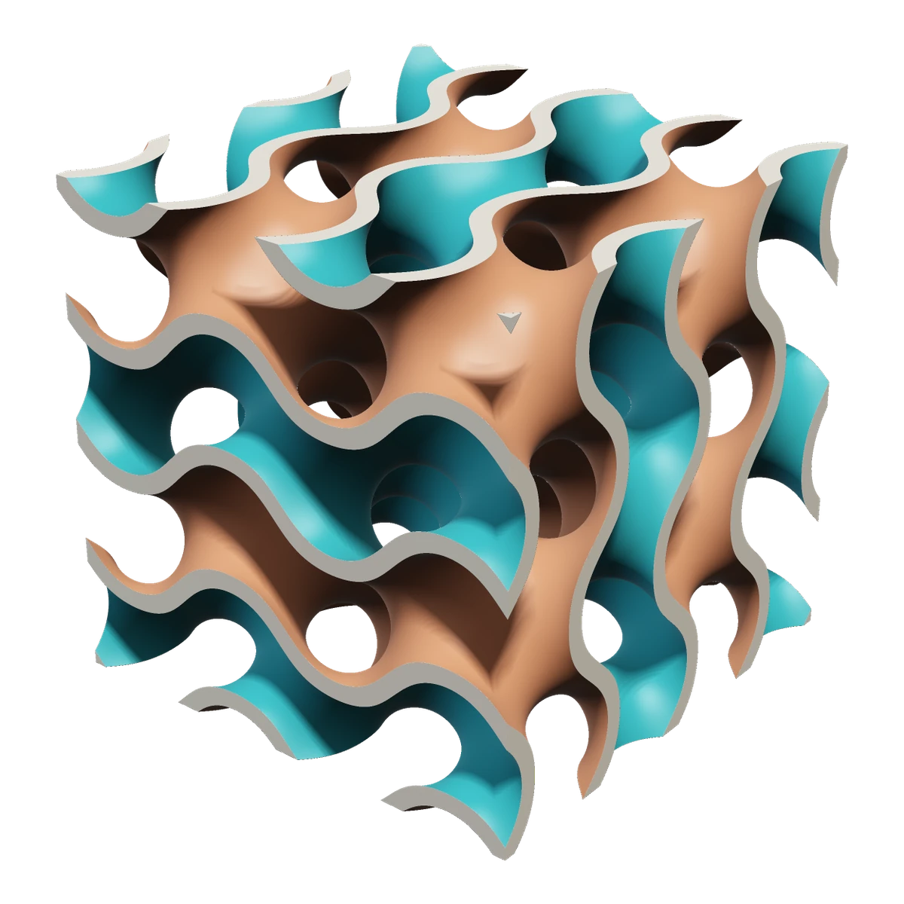

# Geometric variational problems

> This workshop brings together physicists and mathematicians working on geometric variational problems, with an emphasis on problems involving minimisation of the change in curvature along curves and surfaces. 

**Date:** Monday November 30, 2026

**Venue:** Room 360.3.002, Murdoch University ([click for map](https://maps.murdoch.edu.au/?sharepoi=136033.002)).

**Contact:** phil.schrader@murdoch.edu.au

## Schedule 

| Time          |                         |
|---------------|--------------------------|
| 09:15  | Coffee & Welcome      |
| 09:30  | Gerd Schröder-Turk: [Triply-periodic minimal surfaces with network topology and their (necessarily finite) Gauss curvature variations](#Gerd)               |
| 10:30  | Morning Tea                     |
| 11:00  | Hao Chen: [The Primitive and Diamond surfaces locally minimize the variance of Gauss curvature](#Hao)            |
| 12:00  | Jonas Kew: [The Sobolev gradient flow finds geodesics](#Jonas)             |
| 13:00  | Lunch                       |
| 14:00  | Free time / discussion      |
| 15:00  | Phil Schrader: Curves of minimax spirality             |
| 16:00  | James Warman:  [Critical points of total squared spirality with length and curvature penalties](#James)                         |
| 16:45  | Afternoon tea               |
| 17:00  | Glen Wheeler:    [Dynamical properties of the length-penalised ideal functional](#Glen)              |
| 18:00  | Dinner:  [Bar Apothecary](https://maps.app.goo.gl/bnABiuhXWPTFgvSD8)               |

---

## Abstracts

#### Triply-periodic minimal surfaces with network topology and their (necessarily finite) Gauss curvature variations

**Gerd Schröder-Turk**, Murdoch University

**Abstract**

In this talk I will give a brief overview of why triply-periodic minimal surfaces appear in materials science and why their Gauss curvature variations are related to self-assembly processes. I will then talk in some detail about our numerical study of Gauss curvature variations amongst a broad class of periodic and non-periodic minimal surfaces with network-topology. The long-standing hypothesis that three (isometric) particular surfaces known as Gyroid, Diamond and Primitive surfaces have the lowest variations stands. These surfaces may well be nature’s best, albeit imperfect, attempt at embedding the hyperbolic plane in Euclidean space.

Reference: M. Himmelmann, M. C. Pedersen, M. A. Klatt, P. W. A. Schönhöfer, M. E. Evans, G. E. Schröder-Turk; Amorphous bicontinuous minimal surface models and the superior Gaussian curvature uniformity of diamond, primitive and gyroid surfaces. Proc. R. Soc. A 1 January 2026; 482 (2329): 20250275. https://doi.org/10.1098/rspa.2025.0275

[↑Back to schedule](#top)

---

#### The Primitive and Diamond surfaces locally minimize the variance of Gauss curvature
**Hao Chen**,  ShanghaiTech University

**Abstract**

We prove that the Schwarz’ Primitive (P) and Diamond (D) surfaces are local
minimizers of the variance of Gaussian curvature among local deformations within
the moduli space of triply periodic minimal surfaces of genus 3 (TPMSg3s). Our
approach interprets the branch values of the Gauss map as a configuration of
eight points on the sphere and expresses the variance of Gaussian curvature as
the product of two integrals involving exponentials of Green’s functions. We
then show that the Hessian of this functional is positive definite at the cubic
configuration when restricted to antipodal deformations, thereby establishing
the local minimality of the P and D surfaces. Along the other deformation
directions, the Hessian is positive definite except for a two-dimensional
eigenspace with slightly negative eigenvalues, leaving promising hope that the
Gyroid is also a local minimizer.

[↑Back to schedule](#top)

---

#### The Sobolev gradient flow finds geodesics

**Jonas Kew**,  University of Wollongong

**Abstract**

A negative $$H^1(ds)$$-type Sobolev gradient flow of the length functional for curves with fixed end points in a closed smooth Riemannian manifold is studied. Lacking the singularity issues of curve shortening flow, this model is suitable for finding geodesics between two points on a manifold. Indeed, it can be shown that the flow exists for all time and converges strongly to a distinct geodesic in the limit. We further show that since the flow preserves the homotopy class of the initial curve (relative to its endpoints), the geodesic found is of this specific class.

[↑Back to schedule](#top)

---

####  Critical points of total squared spirality with length and curvature penalties

**James Warman**,  Murdoch University

**Abstract**

We study the energy functional $$\mathcal{F}[\gamma] = \int_\gamma k_s^2 +\lambda_1k^2 +\lambda_2 ds$$ on closed immersed curves, with $$\lambda_1,\lambda_2>0$$. This energy combines the well studied length-penalised elastica energy with an arc-length derivative of curvature term. We use the direct method to show that $$\mathcal{F}$$ obtains its minimum value. We derive the Euler--Lagrange equation for this system and show that the constant curvature critical points are the n-fold circles with radius $$\sqrt{\lambda_1/\lambda_2}$$. Finally, assuming the curvature is an elliptic function, we derive a closure condition involving the first and second complete elliptic integrals, which implies that a specific figure-eight is a critical point with $$\lambda_2/\lambda_1^2 \approx14.03$$.

[↑Back to schedule](#top)

---

#### Dynamical properties of the length-penalised ideal functional

**Glen Wheeler**,  University of Wollongong

**Abstract**

The ideal functional admits the following dichotomy: if length is bounded along a flow line, then it is convergent. This motivates us to constrain length, with one way of doing so being by penalisation, i.e. adding $$\lambda L$$ to the ideal functional. Doing this has some wonderful effects, well-beyond making available an a-priori length bound: the previous simple stationary space becomes rich, including such wonders as butterflies and lemniscates, and the flow exhibits finite-time singular behaviour. In this talk I will survey these results and give some ideas about the proof. This is joint work with Shinya Okabe.

[↑Back to schedule](#top)